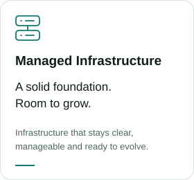
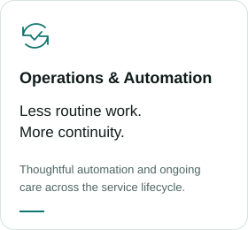

<picture>
  <source media="(prefers-color-scheme: dark)" srcset="https://raw.githubusercontent.com/dienstleistungs-cloud/.github/feb7902d308eeee98e56a837635e38706ee9bfbd/assets/profile/header-dark.svg">
  <source media="(prefers-color-scheme: light)" srcset="https://raw.githubusercontent.com/dienstleistungs-cloud/.github/feb7902d308eeee98e56a837635e38706ee9bfbd/assets/profile/header-light.svg">
  
</picture>

### Hosting and operations for digital services

dienstleistungs.cloud is an independent infrastructure brand focused on hosting
and the ongoing operation of digital services. We build for dependable operation,
maintainability and long-term value.

<picture>
  <source media="(prefers-color-scheme: dark)" srcset="https://raw.githubusercontent.com/dienstleistungs-cloud/.github/feb7902d308eeee98e56a837635e38706ee9bfbd/assets/profile/application-hosting-dark.svg">
  <source media="(prefers-color-scheme: light)" srcset="https://raw.githubusercontent.com/dienstleistungs-cloud/.github/feb7902d308eeee98e56a837635e38706ee9bfbd/assets/profile/application-hosting-light.svg">
  
</picture>
<picture>
  <source media="(prefers-color-scheme: dark)" srcset="https://raw.githubusercontent.com/dienstleistungs-cloud/.github/feb7902d308eeee98e56a837635e38706ee9bfbd/assets/profile/managed-infrastructure-dark.svg">
  <source media="(prefers-color-scheme: light)" srcset="https://raw.githubusercontent.com/dienstleistungs-cloud/.github/feb7902d308eeee98e56a837635e38706ee9bfbd/assets/profile/managed-infrastructure-light.svg">
  
</picture>
<picture>
  <source media="(prefers-color-scheme: dark)" srcset="https://raw.githubusercontent.com/dienstleistungs-cloud/.github/feb7902d308eeee98e56a837635e38706ee9bfbd/assets/profile/operations-automation-dark.svg">
  <source media="(prefers-color-scheme: light)" srcset="https://raw.githubusercontent.com/dienstleistungs-cloud/.github/feb7902d308eeee98e56a837635e38706ee9bfbd/assets/profile/operations-automation-light.svg">
  
</picture>

[dienstleistungs.cloud ↗](https://dienstleistungs.cloud)
